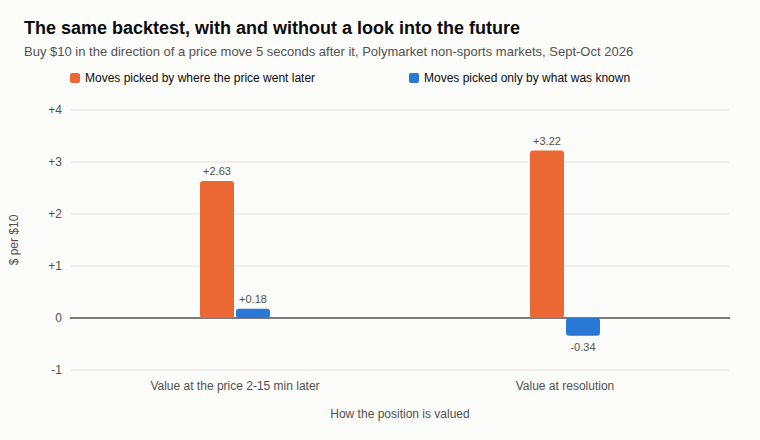
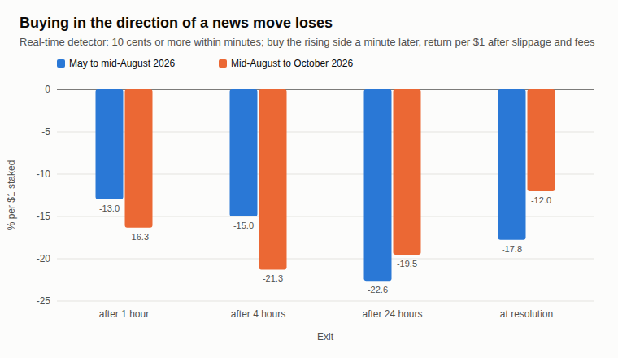
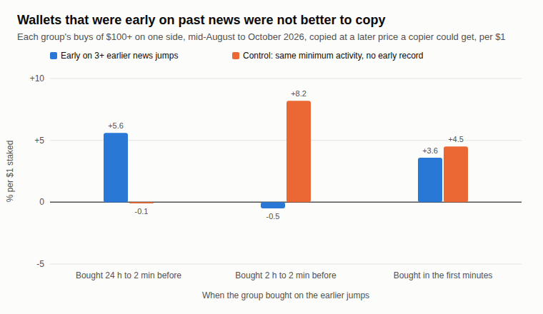
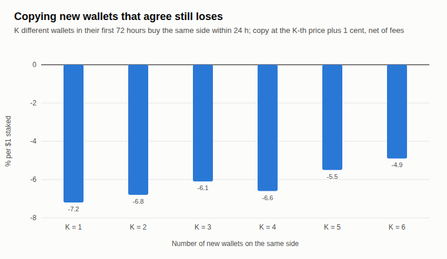

# Polymarket news trading backtest

**Issue 5, November 2026.** Research by the [OrcaLayer](https://orcalayer.com/?utm_source=github&utm_medium=readme&utm_campaign=issue5) team using on-chain Polymarket trades.
Write-up: [Polymarket News Trading: Why Following the Move Loses](https://orcalayer.com/blog/polymarket-news-trading-backtest?utm_source=github&utm_medium=readme&utm_campaign=issue5&utm_content=article).

We tested four ways to trade news on Polymarket in 2026, three of them on non-sports event markets and the fourth on all
markets: tests 1 to 3 at prices observed after the signal, test 4 at the K-th wallet's own price plus 1 cent, always with the
taker fee. None of them showed an edge we could trust. The
one test that looked like a winner, a 5-second news trading bot, came from look-ahead bias, and this repository keeps both
versions so you can see the difference.

## Results

| Idea | What we tested | Result |
|---|---|---|
| A 5-second news bot | 1,218 of 4,303 non-sports price shocks that had a later price, Sept 14 to Oct 14, 2026 | +$0.18 per $10 at the price 2-15 min later, before exit costs (t 1.5); -$0.34 held to resolution |
| The same bot with a look-ahead bug | 510 of 923 moves picked by where the price went later | +$2.63 per $10 (t 10.1): not real |
| Follow a news move a minute late | 1,713 moves of 10 cents or more, May to Oct 2026 | -13.0% to -22.6% of the stake (May to mid-Aug), -12.0% to -21.3% (mid-Aug to Oct) |
| Copy wallets that were early on past news | 3 windows, 120 to 417 wallets, copied mid-Aug to Oct 21 | +5.6% / -0.5% / +3.6% against a control of -0.1% / +8.2% / +4.5%; no difference is statistically significant |
| Copy new wallets that agree | K = 1 to 6 wallets in their first 72 hours, Sept to Oct 2026 | -7.2% to -4.9% of the stake after fees |

t-statistics are plain (not clustered); trades on the same event are not independent. Tests 1 and 2 leave out markets that
count mentions or posts.









## Data

| File | What it holds |
|---|---|
| [`shocks_5s.csv`](data/shocks_5s.csv) | Honest test: every price shock (the first trade at least 5 cents away from the median of the previous 5 minutes): the level before, the first trade, the level 2-15 minutes later, the price of the first trade 1, 2, 5, 10, 30 and 60 seconds after, and the YES payout |
| [`lookahead_jumps.csv`](data/lookahead_jumps.csv) | The look-ahead version, same columns: a move counts only if the level 2-15 minutes later is at least 10 cents away from the level before (it needs the future) |
| [`news_moves.csv`](data/news_moves.csv) | Every trigger of the real-time move detector: minute, volume-weighted price before and now, the rising side, its volume-weighted price over the next 3 minutes (before the 2-cent slippage and the fee), and the return of following or fading the move after 1 h, 4 h, 24 h and at resolution |
| [`early_buyers_copy.csv`](data/early_buyers_copy.csv) | Copying wallets that were early on earlier news jumps against a control group: one row per window and group (aggregates only); `wallets` counts each group before bots (more than 40,000 fills on one side) were dropped from the copy |
| [`newcomer_consensus.csv`](data/newcomer_consensus.csv) | Copying K new wallets that bought the same side: net and gross return by K, by market segment and by month (aggregates only) |

All prices are YES prices, from 0 to 1. `move` is the first trade minus the level before in `shocks_5s.csv`, and the level
2-15 minutes later minus the level before in `lookahead_jumps.csv` (that is the look-ahead). Returns in `news_moves.csv`
are per $1 staked, with a floor of -100%. How each test is built: [METHOD.md](METHOD.md).

## Check it yourself

```bash
python3 scripts/summarize_news_trading.py
```

Python 3.9+ and the standard library only. The script reads the CSV files and prints the results in the table above.

## What is not here

- **Wallet addresses.** The copy tests are published as group aggregates only. We report how groups of wallets trade and do
  not name any wallet.
- **Our internal pipeline.** The numbers come from our own indexer and database of on-chain Polymarket trades.

## Earlier issues

- [Polymarket insider score: cheap entries, not foresight](https://orcalayer.com/blog/polymarket-insider-score-entry-price?utm_source=github&utm_medium=readme&utm_campaign=issue5) ([repo](https://github.com/orcalayer/polymarket-insider-score-backtest))
- [Live football: late goals and stop-losses](https://orcalayer.com/blog/polymarket-live-football-late-goals-stop-loss?utm_source=github&utm_medium=readme&utm_campaign=issue5) ([repo](https://github.com/orcalayer/polymarket-football-late-goal-stop-loss-backtest))
- [Copying Polymarket whales](https://orcalayer.com/blog/polymarket-copy-trading-whales-backtest?utm_source=github&utm_medium=readme&utm_campaign=issue5) ([repo](https://github.com/orcalayer/polymarket-copy-trading-whales-backtest))
- [Polymarket strategies that don't work](https://orcalayer.com/blog/polymarket-strategies-that-dont-work?utm_source=github&utm_medium=readme&utm_campaign=issue5) ([repo](https://github.com/orcalayer/polymarket-arbitrage-market-making-copy-trading-backtests))

## License

Data, charts and text: [CC BY 4.0](LICENSE). Please credit "OrcaLayer Research" with a link to this repository.

This is research, not financial advice.
